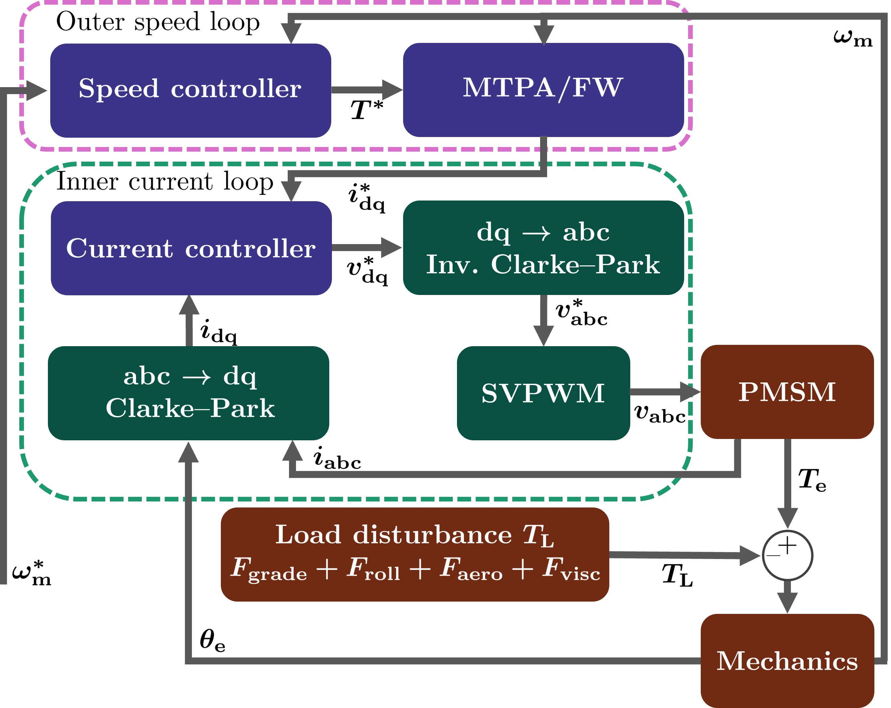
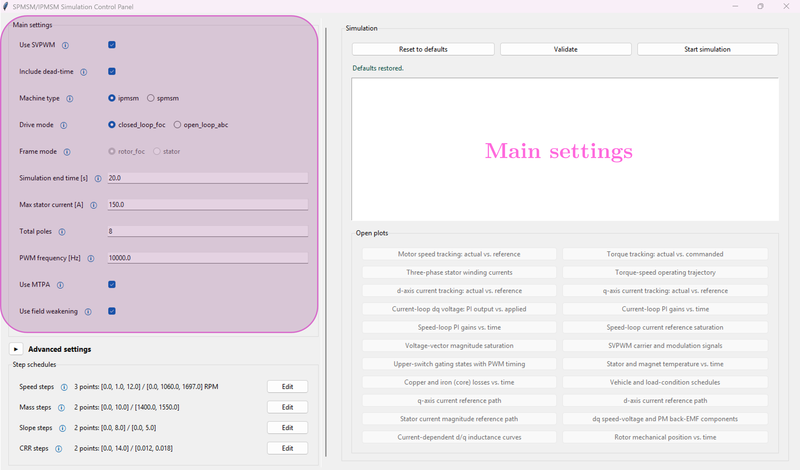
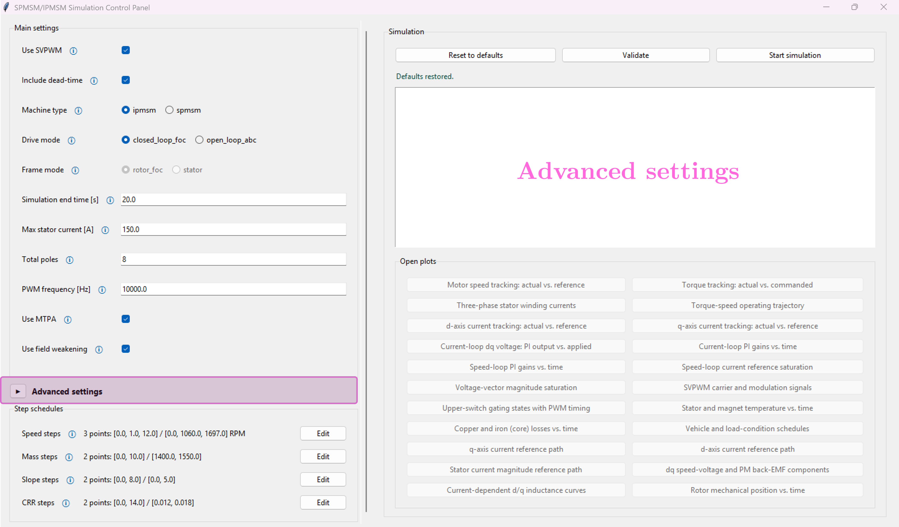
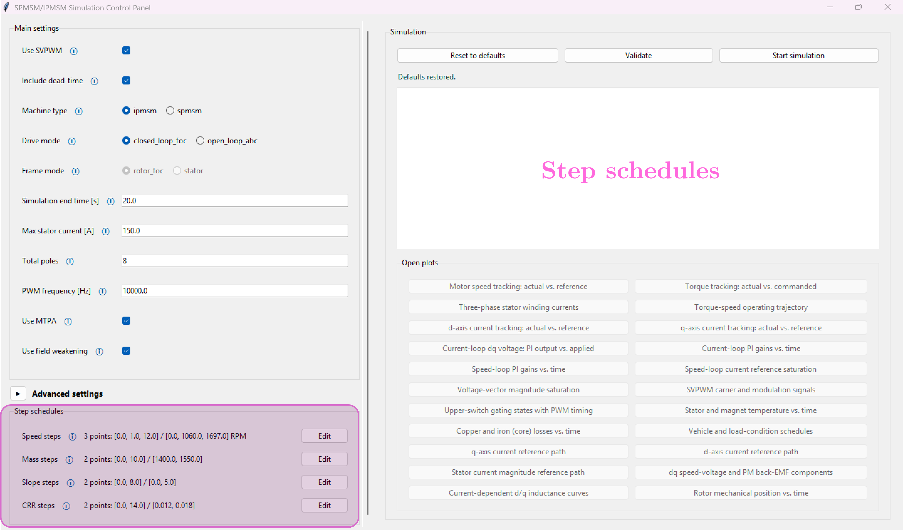
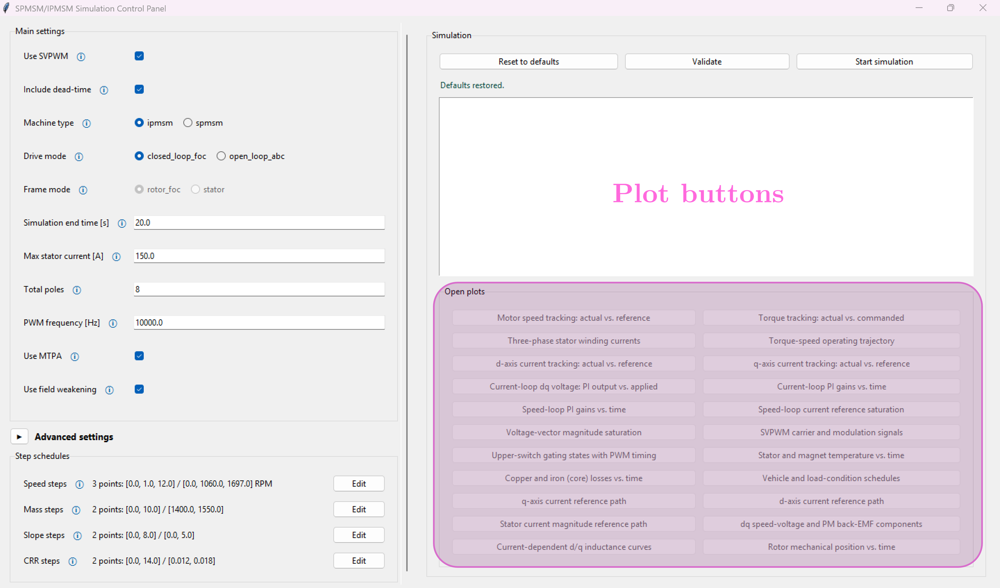
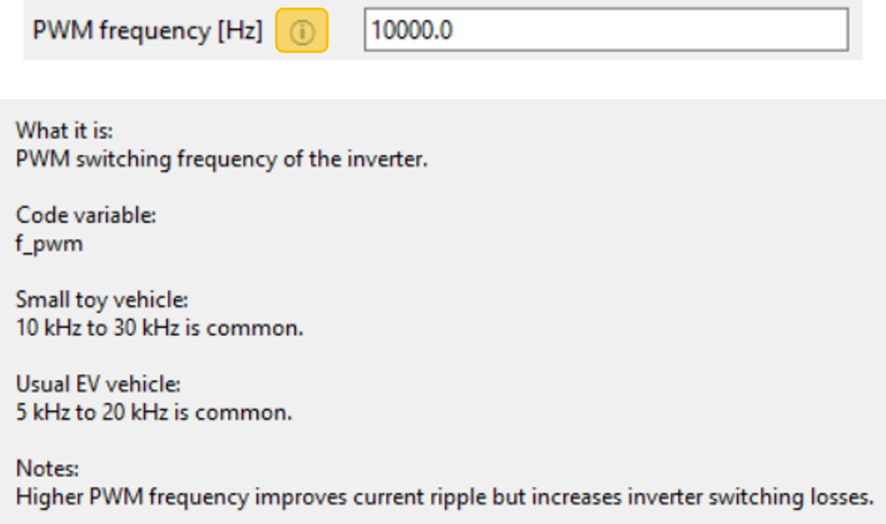
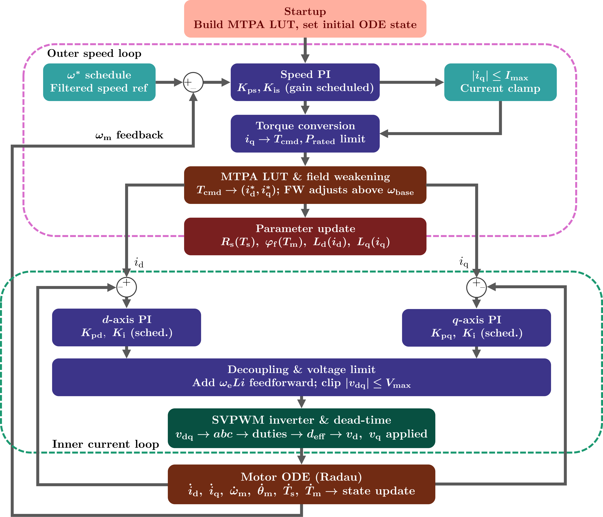
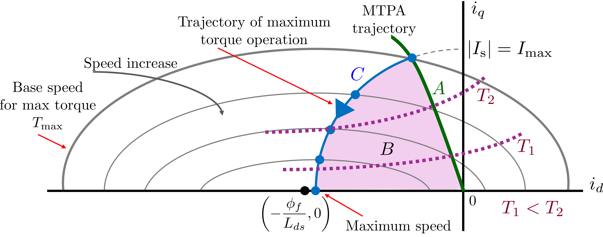
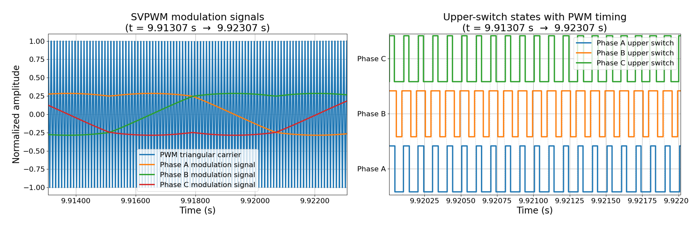

# FOCsy

**FOCsy** is an open-source Python simulation library for closed-loop field-oriented control (FOC) of permanent-magnet synchronous motor (PMSM) traction drives. It combines a cascaded speed/current control loop with MTPA and field-weakening reference generation, SVPWM with dead-time compensation, current-dependent magnetic saturation, a two-node thermal model with gain scheduling (stator and magnet), and a physics-based vehicle road-load model — all accessible through both a graphical interface and a plain Python API.

<p align="center">
  
</p>

*Outer speed loop, MTPA/field-weakening reference generation, inner current loop, SVPWM + dead-time, and the PMSM/mechanical/load plant.*

## Features

- **Closed-loop FOC** — cascaded outer speed / inner current PI loops in the rotor dq frame, with pole-zero-cancellation gains and explicit cross-coupling decoupling.
- **MTPA** — maximum-torque-per-ampere current references for IPMSMs, solved offline via Brent's method and tabulated in a 1D lookup table (`pmsm_backend/mtpa.py`).
- **Field weakening** — above base speed, the controller weakens the field in three stages (MTPA, voltage-limited, and voltage-and-current-limited) rather than pinning current to its limit the moment base speed is crossed, using a dedicated 2D lookup table to find the right operating point in the voltage-limited case (`pmsm_backend/fw_lut.py`).
- **SVPWM with dead-time compensation** — space-vector PWM injects a zero-sequence offset voltage into the three-phase references before comparing them against a center-aligned triangular carrier. That offset extends the usable linear modulation range, raising the maximum achievable output voltage by about 15% over plain sinusoidal PWM for the same DC bus, and center-aligning the carrier keeps each switch's on/off edges symmetric within the carrier period, which cuts the number of commutations (and the switching losses that go with them) and smoothens the effective current ripple compared to an edge-aligned carrier at the same switching frequency. An average dead-time voltage-error model then corrects for the brief interlock time every real inverter leg needs between turning one switch off and the other on — left uncompensated, that gap distorts the applied voltage in a current-sign-dependent way, so correcting it removes the resulting low-order harmonics and reduces both torque ripple and the extra losses that distortion would otherwise cause (`pmsm_backend/pwm.py`).
- **Magnetic saturation** — current-dependent $L_{\mathrm{d}}(i_{\mathrm{d}})$, $L_{\mathrm{q}}(i_{\mathrm{q}})$ via a bounded saturation law, feeding back into both the control gains and the torque equation. Explained in detail in GUI - advanced settings.
- **Thermal-aware gain scheduling** — a two-node stator/magnet thermal network that drives temperature-dependent $R_{\mathrm{s}}$ and PM flux $\phi_{\mathrm{f}}$, with controller gains recomputed at every time step to track the real machine instead of a fixed design point.
- **Iron (core) losses** — a Steinmetz-style hysteresis/eddy-current loss model, added as an extra heat source at the stator thermal node. Explained in detail in GUI - advanced settings.
- **Vehicle road-load model** — grade, rolling resistance, aerodynamic drag, and a lumped viscous loss term, converted to a load torque with reflected inertia at the motor shaft.
- **Stiff ODE integration** — a 13-state coupled electrical/mechanical/thermal/control model integrated with the implicit Radau method, appropriate for the large electrical/mechanical/thermal timescale separation.
- **GUI and script API** — a Tkinter GUI (`pmsm_gui/`) with per-parameter tooltips for interactive use, and a single headless entry point, `run_pmsm_simulation(params)`, for scripting, parameter sweeps, and automated testing.

## Screenshots

<table>
  <tr>
    <td width="50%" valign="top">
      <p align="center"></p>
      <sub>Main settings: machine type, drive mode, SVPWM/dead-time, MTPA, and field-weakening toggles.</sub>
    </td>
    <td width="50%" valign="top">
      <p align="center"></p>
      <sub>Advanced settings is a collapsible section that stays out of the way until you need it: electrical and saturation coefficients, thermal and iron-loss parameters and the PWM/solver configuration all live here, each with the same tooltip support as the main fields.</sub>
    </td>
  </tr>
  <tr>
    <td width="50%" valign="top">
      <p align="center"></p>
      <sub>Step schedules expose time-varying speed reference, mass, slope, and rolling-resistance schedules.</sub>
    </td>
    <td width="50%" valign="top">
      <p align="center"></p>
      <sub>Built-in plots — tracking, losses, PWM waveforms, temperatures, and more — available after each run.</sub>
    </td>
  </tr>
</table>


<p align="center">
  
</p>

*Every field has a tooltip explaining what it is, its code variable, and typical values for a small lab vehicle vs. a real EV.*

## Requirements

- Python 3.10–3.12
- `tkinter` (ships with Python on most platforms; on Ubuntu/Debian you may need `sudo apt install python3-tk`)

Install the Python dependencies with:

```bash
pip install -r requirements.txt
```

`requirements.txt`:

```
numpy>=1.26,<3.0
scipy>=1.11,<2.0
matplotlib>=3.8,<4.0
```

## Quick start

### GUI

```bash
python main.py
```

This opens the Tkinter interface, where parameters are organized into main and advanced-settings panels, step schedules (speed, mass, slope, rolling resistance), and simulation controls — each field accompanied by a tooltip describing its meaning, typical ranges, and the underlying code variable.

### Script / API

The same backend can be called directly, without the GUI, for parameter sweeps or automated testing:

```python
from pmsm_backend.runner import run_pmsm_simulation
from pmsm_gui.settings import DEFAULTS, rpm_to_rad_s

params = dict(DEFAULTS)
params["machine_type"] = "ipmsm"
params["use_mtpa"] = True
params["use_field_weakening"] = True
params["t_steps"] = [0.0]
params["omega_steps"] = [rpm_to_rad_s(3000.0)]

result = run_pmsm_simulation(params)

print(result.keys())
```

`run_pmsm_simulation` returns a dictionary of time-sampled arrays — dq and three-phase currents/voltages, speed, torque, stator/magnet temperature, and MTPA/FW reference currents — all resampled onto a common, fixed-rate time grid regardless of the ODE solver's internal adaptive step size.

## Project structure

```
pmsm_backend/
|-- config.py          # dataclass + params-dict -> PMSMConfig
|-- mtpa.py            # MTPA lookup table (Brent's method, built once at startup)
|-- fw_lut.py          # Field-weakening Regime-B lookup table
|-- pwm.py             # SVPWM, duty cycles, dead-time compensation
|-- transforms.py      # Clarke-Park transform, dq voltage-vector saturation
|-- simulation.py      # 13-state ODE model, Radau integration, PMSMSimulation
|-- runner.py          # Public entry point: run_pmsm_simulation(params)
pmsm_gui/
|-- app.py             # Main Tkinter window, plotting
|-- settings.py        # Default parameters, FieldSpec-driven form definitions
|-- help_text.py       # Per-parameter tooltip text
|-- widgets.py         # Reusable widgets (scrollable frame, schedule editor, tooltip)
main.py                # GUI entry point
requirements.txt
```

## How it works

<p align="center">
  
</p>

*One simulation step: gain-scheduled speed loop → MTPA/field-weakening lookup → parameter update → current loop → SVPWM + dead-time → ODE integration.*

Speed control is cascaded: a slow outer speed loop converts the speed error into a torque command, which an MTPA/field-weakening block converts into d/q current references, tracked by a fast inner current loop. Both loops are tuned to their own bandwidth ($\omega_{\mathrm{cc}}$ for current, $\omega_{\mathrm{cs}}$ for speed) using pole-zero-cancellation PI gains, kept constant even as the motor saturates, heats up, or the vehicle load changes — the gains themselves are recomputed every time step from the instantaneous, temperature- and current-dependent machine parameters.

Below base speed, the controller draws the minimum current that produces the required torque (MTPA), solved offline over a dense torque grid and retrieved online by interpolation. For a given torque command, this means finding the $(i_{\mathrm{d}}, i_{\mathrm{q}})$ pair of smallest magnitude that satisfies the electromagnetic torque equation

$$
T_{\mathrm{e}} = \frac{3}{2}\,p\left(\phi_{\mathrm{f}}\,i_{\mathrm{q}} + (L_{\mathrm{d}} - L_{\mathrm{q}})\,i_{\mathrm{d}}\,i_{\mathrm{q}}\right).
$$

Above base speed, the back-EMF approaches the inverter's voltage limit, and the controller weakens the field by driving $i_{\mathrm{d}}$ negative. This happens in up to three regimes, shown below: MTPA still fits inside the voltage limit (Regime A); the voltage limit alone is active and the torque command can be met with less than the full current limit (Regime B, its own dedicated 2D lookup table); or both the voltage and current limits are active simultaneously, in which case the reference is the closed-form intersection of the current-limit circle and the voltage-limit ellipse (Regime C).

<p align="center">
  
</p>

*The MTPA trajectory (A) and the field-weakening path as speed increases, split into the voltage-limited Regime B and the voltage-and-current-limited Regime C, bounded by the current-limit circle $|I_{\mathrm{s}}| = I_{\mathrm{max}}$.*


## Configuration

All simulation parameters — electrical, thermal, saturation, vehicle, PWM/solver, and schedule settings — are defined in `pmsm_gui/settings.py` (`DEFAULTS`, `MAIN_FIELDS`, `ADV_FIELDS`) with matching explanations, typical ranges for both small test setups and full-scale EV traction drives, and the exact code variable each one maps to, in `pmsm_gui/help_text.py`. The GUI surfaces this text as hover/click tooltips next to every field. The same dictionary is a convenient reference when calling `run_pmsm_simulation` directly from a script.

## Example output

<p align="center">
  
</p>

*One of the built-in diagnostic plots: SVPWM modulation signals against the triangular carrier, and the resulting upper-switch gating states.*